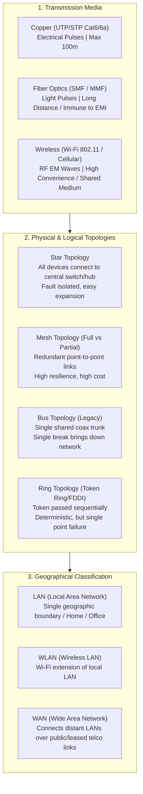

# FREE CCNA // What is a Network? // Day 0

**Tags:** #concept #networking #topologies #ccna #alvar-method
**Category:** Cybersecurity / 01-Networking
**Reference Video:** [Day 0: FREE CCNA // What is a Network?](https://www.youtube.com/watch?v=S7MNX_UD7vY)

---

## 1. Unconditional Truths (The Axioms)

- **A network requires four fundamental components to exist:**
  1. **Endpoints (Senders / Receivers):** Devices originating or terminating data (PCs, servers, IoT devices, printers).
  2. **Intermediary Devices:** Hardware that directs and manages traffic between endpoints (Switches, Routers, Access Points, Firewalls).
  3. **Transmission Medium:** Physical or wireless pathways carrying signals (Copper UTP, Fiber Optic, Radio Waves / RF).
  4. **Shared Protocols:** Agreed-upon rules defining how data is formatted, addressed, transmitted, and interpreted (e.g., Ethernet, IP, TCP, HTTP).
- **Physical topology does NOT equal logical topology:** How cables are physically routed (physical layout) can differ completely from the path electrical or optical signals take to communicate (logical flow).
- **Communication speed is bounded by physical limits:** Bandwidth represents theoretical pipeline capacity; actual throughput is always throttled by propagation delay, serialization delay, queuing, and packet loss.

---

## 2. Motivated Discovery ("Why does this exist?")

*Before computer networks, the only method to transfer data between distinct machines was the **"Sneakernet"**—physically carrying storage media (punch cards, magnetic tapes, floppy disks) by foot.*

### Breaking Points of the Sneakernet:
1. **Zero Real-Time Synchronization:** Concurrent work on shared datasets resulted in irreconcilable merge conflicts and stale states.
2. **Resource Duplication:** Every single terminal required dedicated peripherals (expensive printers, tape drives, storage arrays).
3. **Catastrophic Latency:** Moving physical media across rooms or buildings creates latencies measured in minutes or days rather than milliseconds.

Networks were engineered to transform isolated compute nodes into a unified, collaborative fabric where compute, storage, and peripheral access are abstracted across space.

---

## 3. Architecture & Dependency Map

---

## 4. First-Principles Mechanics

### Performance Metrics: The Holy Trinity
Many engineers confuse these terms. Here is their first-principles breakdown:

$$\text{Goodput} \le \text{Throughput} \le \text{Bandwidth}$$

1. **Bandwidth:** The theoretical maximum capacity of the transmission link (e.g., a $1\text{ Gbps}$ Gigabit Ethernet link).
2. **Throughput:** The actual volume of raw data (including all protocol overhead and retransmissions) successfully traversing the link per second (e.g., $850\text{ Mbps}$).
3. **Goodput:** The actual application-level payload received without protocol headers, trailers, or retransmissions (e.g., pure file bytes downloaded per second).
4. **Latency (Delay):** Total time taken for a bit to travel from sender to receiver:
   $$\text{Total Latency} = \text{Propagation Delay} + \text{Serialization Delay} + \text{Queuing Delay} + \text{Processing Delay}$$
5. **Jitter:** The statistical variance in packet arrival latency. High jitter ruins real-time VoIP and video streams.

---

## 5. Network Topologies Comparison

| Topology | Fault Tolerance | Cost / Cabling | Bottleneck / SPOF | Modern Use Case |
| :--- | :--- | :--- | :--- | :--- |
| **Star** | High (one cable cut only drops that one host) | Moderate | The central switch/hub | Standard enterprise office & home LANs |
| **Full Mesh** | Extreme ($N(N-1)/2$ links) | Very High | None (fully redundant) | Data center spines, critical ISP backbones |
| **Partial Mesh**| High (key nodes have dual links) | High | Minimal | Enterprise WAN links connecting branch offices |
| **Bus (Legacy)**| Zero (single trunk break kills entire network) | Minimal | The central coaxial backbone | Legacy industrial networks, CAN bus in automobiles |
| **Ring** | Low (unless dual counter-rotating ring) | Moderate | Any node failure in simple ring | FDDI, SONET/SDH telco loops |

---

## 6. Cybersecurity Implications & Threat Modeling

1. **Shared vs Isolated Collision Mediums:**
   - In shared media (like legacy Bus topology or unencrypted Wi-Fi), any device placed into **promiscuous mode** can sniff all raw traffic passing through the air or wire.
2. **Single Point of Failure (SPOF):**
   - Star topologies centralize communication at the switch. If an adversary knocks out the switch (power loss, DoS, physical sabotage), the entire subnet is blinded.
3. **Physical Wiretapping:**
   - Copper cables radiate electromagnetic fields that can be captured with inductive taps without cutting the wire. Fiber optics are significantly more tamper-resistant because physical tapping causes detectable light loss.

---

## 7. Gotchas & Common Pitfalls

- ⚠️ **Gotcha 1: Confusing Bits and Bytes:**
  - Network bandwidth is quoted in **bits per second** ($b/s$ or $bps$).
  - Storage and file sizes are quoted in **Bytes** ($B$, where $1\text{ Byte} = 8\text{ bits}$).
  - *Example:* A $100\text{ Mbps}$ internet connection will download a file at a maximum of $12.5\text{ MB/s}$ ($100 / 8$).
- ⚠️ **Gotcha 2: Thinking Wi-Fi is Full-Duplex:**
  - Wi-Fi is inherently **half-duplex** (shared radio frequency medium). Only one device can transmit on a channel at any millisecond; all others must listen to avoid RF collision (CSMA/CA).

---

## 🧠 Socratic Self-Check (Test Your Knowledge)

1. *If an enterprise has 6 core routers and wants a full mesh topology between them, exactly how many physical links are required?*
   - **Answer:** $\frac{N(N-1)}{2} = \frac{6 \times 5}{2} = 15\text{ links}$.
2. *Why does modern networking overwhelmingly use star (or star-wired bus/tree) topology instead of pure bus topology?*
   - **Answer:** In a star topology, a cable severance isolates only a single workstation without bringing down the rest of the company, and upgrades/troubleshooting can be performed per port on the central switch.
