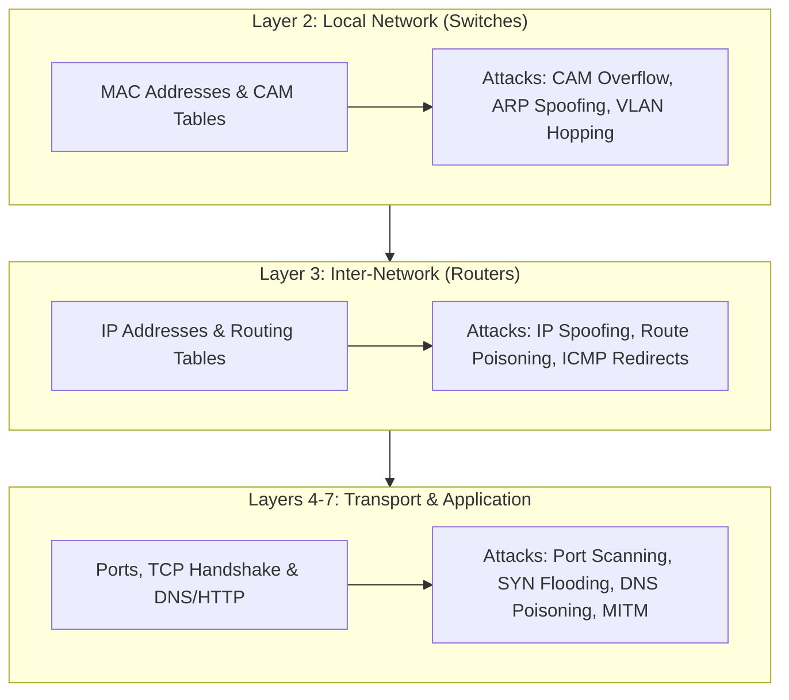

# 🌐 Networking Mastery Index & Architecture Blueprint

**Tags:** #networking #ccna #cybersecurity #packet-tracer #alvar-method
**Category:** Cybersecurity / Core Infrastructure
**Course Track:** [NetworkChuck Free CCNA 200-301 Course](https://youtube.com/playlist?list=PLIhvC56v63IJVXv0GJcl9vO5Z6znCVb1P)

---

## 1. Why Networking is the Backbone of Cybersecurity

In cybersecurity, **you cannot defend or exploit what you do not understand**. Every attack vector—from an ARP poisoning MITM attack on a local subnet to advanced lateral movement across enterprise Active Directory domains—relies on manipulating network protocols and hardware behavior.



---

## 2. CCNA Foundation Track: Episodes & Status Tracker

| Episode Title | Alvar Concept Note | Packet Tracer Lab / Assets | Security Relevance | Status |
| :--- | :--- | :--- | :--- | :--- |
| **FREE CCNA // What is a Network? // Day 0** | [[00 - FREE CCNA -- What is a Network -- Day 0\|Day 0 Notes]] | Conceptual Topologies | Attack surfaces, Single Points of Failure (SPOF) | ✅ Mastered |
| **What is a SWITCH? // FREE CCNA // Day 1** | [[01 - What is a SWITCH -- FREE CCNA -- Day 1\|Day 1 Notes]] | `labs/ccna_day1.pkz` | MAC flooding, Port Security, Promiscuous sniffing | ✅ Mastered |
| **What is a ROUTER? // FREE CCNA // EP 2** | [[02 - What is a ROUTER -- FREE CCNA -- EP 2\|EP 2 Notes]] | `labs/ccna_ep2.pkz` | Subnet isolation, Gateway hijacking, ARP poison | ✅ Mastered |
| **what is TCP/IP and OSI? // FREE CCNA // EP 3** | [[03 - what is TCPIP and OSI -- FREE CCNA -- EP 3\|EP 3 Notes]] | ARPANET Map, OSI vs TCP/IP Blackboard | Defense-in-depth, Layered attack taxonomy, Boson FAQ | ✅ Mastered |
| **REAL LIFE example!! (TCP/IP and OSI layers) // FREE CCNA // EP 4** | [[04 - REAL LIFE example (TCPIP and OSI layers) -- FREE CCNA -- EP 4\|EP 4 Notes]] | Live Encapsulation Packet Flow | Packet sniffing (Wireshark), Header manipulation, Boson FAQ | ✅ Mastered |
| **How the OSI model works on YouTube // FREE CCNA // EP 5** | *Upcoming* | Transport Layer Lab | DoS/DDoS (SYN flood, UDP reflection) | ⏳ Next Up |
| **DO NOT design your network like this!! // FREE CCNA // EP 6** | *Upcoming* | 3-Tier Enterprise Lab | Perimeter defense, DMZ architecture | ⏳ Scheduled |

---

## 3. The Protocol Data Unit (PDU) Mental Model

Remember the mnemonic: **"Don't Some People Fly By?"**

```mermaid
sequenceDiagram
    autonumber
    participant App as Application Layer (Data)
    participant Trans as Transport Layer (Segment)
    participant Net as Network Layer (Packet)
    participant Link as Data Link Layer (Frame)
    participant Phys as Physical Layer (Bits)

    App->>Trans: Adds Source & Destination Port (e.g. 52140 -> 80)
    Trans->>Net: Adds Source & Destination IP (e.g. 192.168.1.10 -> 172.16.1.100)
    Net->>Link: Adds Source & Destination MAC (e.g. Host MAC -> Default Gateway MAC)
    Link->>Phys: Serializes Frame into 0s and 1s (Voltage / Light / Radio pulses)
```

---

## 4. Cisco IOS Fast Command Reference (Packet Tracer)

### Mode Navigation
```cisco
Switch> enable                    ! Enter Privileged EXEC Mode (#)
Switch# configure terminal        ! Enter Global Configuration Mode
Switch(config)# interface fa0/1   ! Enter Interface Configuration Mode
Switch(config-if)# exit           ! Back to previous configuration level
Switch(config)# end               ! Jump directly back to Privileged EXEC Mode (#)
```

### Layer 2 Switch Verification
```cisco
Switch# show mac address-table              ! View learned MACs and their associated ports
Switch# show mac address-table dynamic      ! View only dynamically learned MAC addresses
Switch# clear mac address-table dynamic     ! Flush the CAM table (forces new learning)
Switch# show interfaces status              ! View physical port states and VLAN assignments
```

### Layer 3 Router Verification
```cisco
Router# show ip route                       ! View active routing table (L3 decisions)
Router# show ip interface brief             ! High-level summary of IP addresses & interface status
Router# show arp                            ! Inspect the router's ARP cache (IP -> MAC mappings)
Router# ping <destination-ip>               ! Send ICMP echo requests to test L3 reachability
Router# traceroute <destination-ip>         ! Trace router hops along the path to destination
```

---

## 5. Lab Directory Structure

All source `.pkz` files provided by NetworkChuck are stored in `01-Networking/labs/`:
- `ccna_day1.pkz`: Switch fundamentals & CAM table population lab.
- `ccna_ep2.pkz`: Multi-subnet routing, default gateways, and NetworkChuck Coffee server lab.
- `attachments/`: Contains all screenshots and whiteboard diagrams extracted from episodes.
