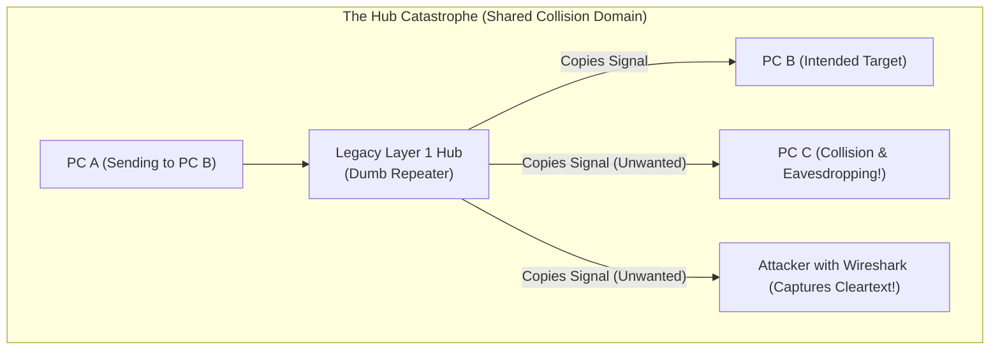
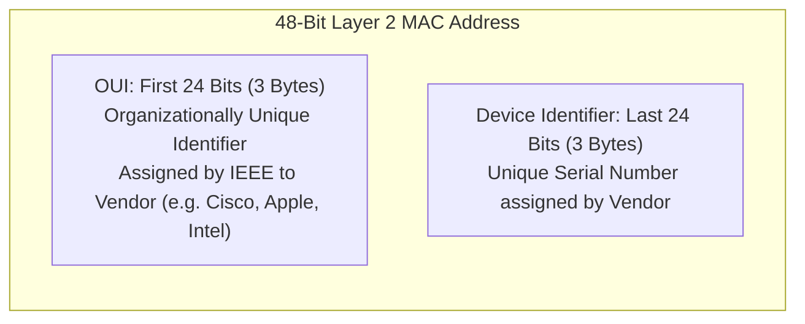
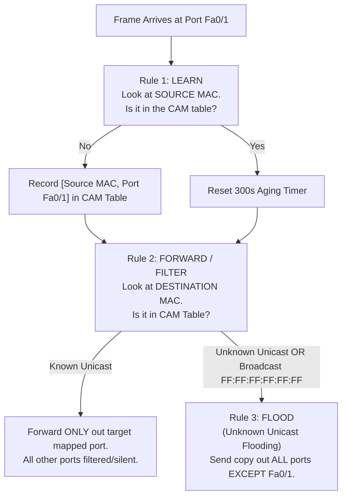
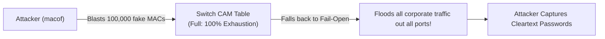

# What is a SWITCH? // FREE CCNA // Day 1

**Tags:** #concept #networking #switch #layer2 #mac-address #ccna #alvar-method
**Category:** Cybersecurity / 01-Networking
**Reference Video:** [Day 1: What is a SWITCH? // FREE CCNA](https://www.youtube.com/watch?v=9eH16Fxeb9o)
**Source Lab File:** `01-Networking/labs/ccna_day1.pkz`

---

## 1. Unconditional Truths (The Axioms)

- **Switches operate at Layer 2 (Data Link Layer):** They make forwarding decisions purely on physical **MAC (Media Access Control) addresses**, knowing nothing about Layer 3 IP addresses.
- **Switches learn by SOURCE MAC; they forward by DESTINATION MAC:**
  - A switch NEVER learns a MAC address by looking at the destination header.
  - A switch records the sender's MAC address and the physical port it arrived on into its **CAM (Content Addressable Memory) table**.
- **Switches eliminate Collision Domains, but NOT Broadcast Domains:**
  - Every single port on a switch is its own isolated **Collision Domain** (running Full Duplex).
  - All ports on a switch (in the same VLAN) share a single unified **Broadcast Domain**. If a broadcast frame arrives, every device receives it.

---

## 2. Motivated Discovery ("Why does this exist?")

*Before switches, networks used **Hubs** (Layer 1 repeaters) to interconnect multiple computers.*



### The Breaking Points of Hubs:
1. **Half-Duplex & Collisions:** If two computers transmitted at the exact same time, the electrical voltages collided, corrupting both signals (**CSMA/CD**). The network had to back off exponentially, cutting usable bandwidth to single-digit percentages as nodes increased.
2. **Bandwidth Dilution:** A $10\text{ Mbps}$ hub shared that $10\text{ Mbps}$ across *all* connected devices simultaneously.
3. **Severe Security Flaw:** Because hubs blast electrical signals out of every port indiscriminately, any rogue machine on the network in **promiscuous mode** could capture every user's private passwords, emails, and data streams.

**The Solution:** The **Layer 2 Switch** was engineered with dedicated memory and microchips (ASICs) to inspect incoming frames and forward them **only** to the intended recipient's physical port.

---

## 3. Architecture & Dependency Map

### Anatomy of a 48-bit MAC Address
A MAC address is a 12-digit hexadecimal number ($48\text{ bits} = 6\text{ bytes}$), written as `00:1A:2B:3C:4D:5E` or Cisco format `001a.2b3c.4d5e`.



### The 3 Core Rules of the Switch Engine



---

## 4. Cisco Packet Tracer Lab Walkthrough (`ccna_day1.pkz`)

Open `ccna_day1.pkz` in Cisco Packet Tracer to follow NetworkChuck's hands-on exercise:

### Step 1: Accessing the Switch CLI
Click on the switch in Packet Tracer, select the **CLI** tab, and press Enter:
```cisco
Switch> enable                    ! Move from User EXEC (>) to Privileged EXEC (#)
Switch# show mac address-table    ! Inspect the current CAM table
```
*(Initially, notice the table is often empty or only contains CPU/system entries, because no host has transmitted yet!)*

### Step 2: Triggering the Learning Process
1. Switch to **Simulation Mode** (bottom-right icon or `Shift + S`).
2. On **PC0**, open the Command Prompt desktop app and ping **PC1**:
   ```cmd
   C:\> ping 192.168.1.20
   ```
3. Click the **Capture / Forward** arrow in Packet Tracer:
   - Observe the first packet is an **ARP Request** (`Who has 192.168.1.20? Tell 192.168.1.10`).
   - The ARP frame has Destination MAC `FF:FF:FF:FF:FF:FF` (Broadcast).
   - The switch receives the frame on port `Fa0/1`:
     - It immediately learns PC0's MAC address on `Fa0/1`.
     - Because the destination is Broadcast, it floods the frame out all ports to PC1 and PC2.
   - PC2 discards the frame (IP mismatch).
   - PC1 recognizes its own IP, responds with a unicast ARP reply containing its MAC address.
   - The switch learns PC1's MAC address on `Fa0/2`.

### Step 3: Verifying the CAM Table
Back on the Switch CLI:
```cisco
Switch# show mac address-table
          Mac Address Table
-------------------------------------------
Vlan    Mac Address       Type        Ports
----    -----------       --------    -----
   1    0001.42a1.8b01    DYNAMIC     Fa0/1
   1    0001.42a1.8b02    DYNAMIC     Fa0/2
```
Now, all subsequent ICMP echo packets between PC0 and PC1 are **unicast forwarded** directly between `Fa0/1` and `Fa0/2`. PC2 never receives a single bit!

### Step 4: Testing the Aging Timer
By default, dynamic CAM entries expire after **300 seconds (5 minutes)** of inactivity:
```cisco
Switch# clear mac address-table dynamic   ! Manually flush learned MACs to force re-learning
```

---

## 5. Cybersecurity Threat Modeling (Offensive & Defensive)

### Attack 1: CAM Table Overflow (MAC Flooding Attack)
- **The Concept:** Switches have limited RAM (CAM table size is typically between 8,000 and 128,000 entries).
- **The Exploit:** An attacker running a tool like `macof` (part of `dsniff`) blasts hundreds of thousands of frames per second, each with a randomized fake Source MAC address.
- **The Impact:** The switch's CAM table fills to capacity. Unable to learn new addresses, the switch falls back to **"Fail-Open" mode**—it floods EVERY frame out EVERY port, effectively converting itself into a dumb, promiscuous **Hub**! The attacker can now sniff all confidential traffic across the entire VLAN.



### Defense: Cisco Port Security
To eliminate CAM overflow and unauthorized hardware attachments, configure **Port Security** on access ports:
```cisco
Switch# configure terminal
Switch(config)# interface fa0/1
Switch(config-if)# switchport mode access
Switch(config-if)# switchport port-security                  ! Enable port security
Switch(config-if)# switchport port-security maximum 1        ! Allow only 1 MAC address on this port
Switch(config-if)# switchport port-security mac-address sticky ! Lock in the first MAC detected
Switch(config-if)# switchport port-security violation shutdown ! Erdisable the port if rogue MAC connects
```

---

## 6. Gotchas & Common Pitfalls

- ⚠️ **Gotcha 1: MAC Addresses Only Matter on the Local Subnet:**
  - A MAC address never crosses a router. Once a packet hits a router, the Layer 2 header is stripped off and replaced with a new MAC header for the next hop.
- ⚠️ **Gotcha 2: Unknown Unicast Flooding vs Broadcast Flooding:**
  - Broadcast flooding happens because the Destination MAC is explicitly `FF:FF:FF:FF:FF:FF`.
  - Unknown Unicast flooding happens when the Destination MAC is a normal unicast address, but the switch simply hasn't seen that machine speak yet or its entry aged out.

---

## 🧠 Socratic Self-Check (Test Your Knowledge)

1. *If a switch receives a frame with Source MAC `AAAA.AAAA.AAAA` and Destination MAC `BBBB.BBBB.BBBB` on port `Fa0/3`, and `BBBB.BBBB.BBBB` is NOT in the CAM table, what two things happen?*
   - **Answer:**
     1. The switch records `AAAA.AAAA.AAAA` on port `Fa0/3` in its CAM table.
     2. The switch floods the frame out all active ports on that VLAN except `Fa0/3` (Unknown Unicast Flood).
2. *Why doesn't a switch ever learn a MAC address from the Destination field?*
   - **Answer:** Because the presence of a destination address does not prove that the destination device is attached to that port—it only proves the sender wants to talk to it. Only the sender's physical frame arriving on a specific port proves that host is connected there.
