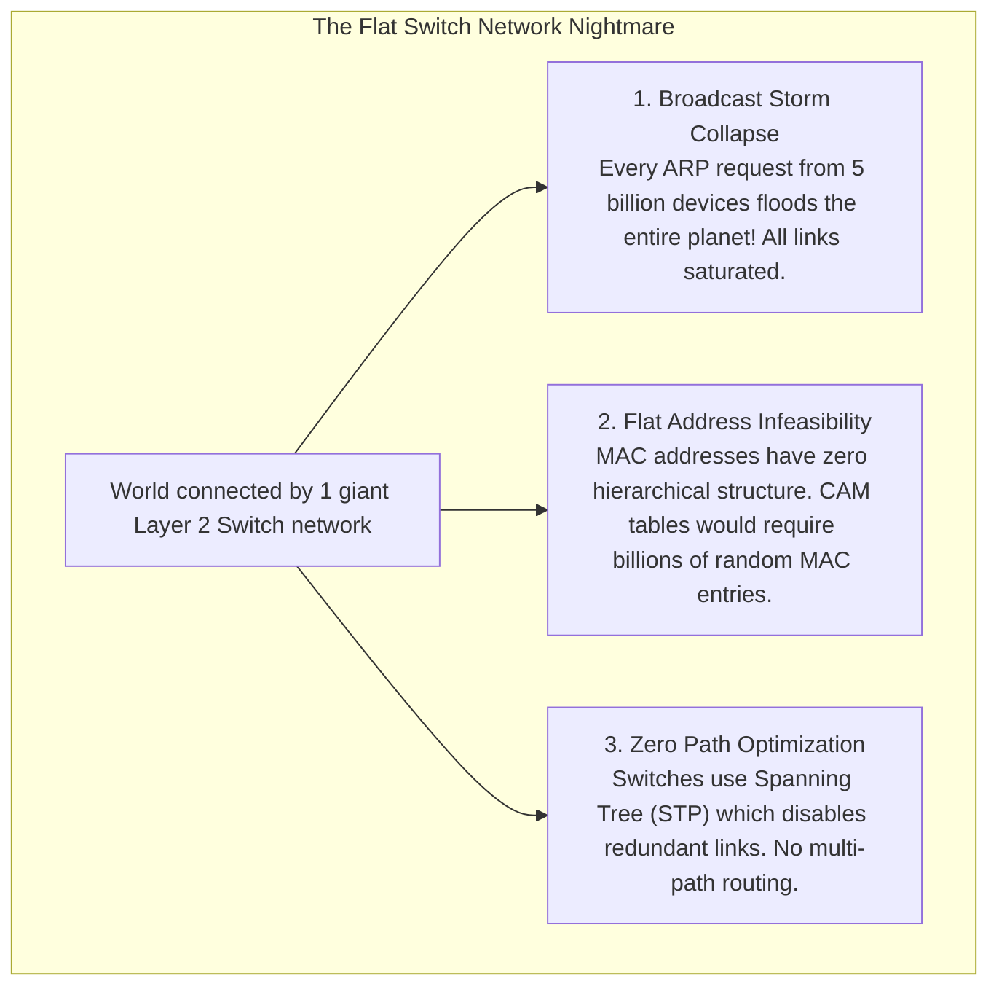
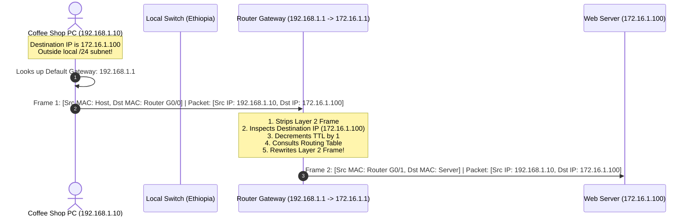

# What is a ROUTER? // FREE CCNA // EP 2

**Tags:** #concept #networking #router #layer3 #ip-routing #arp #ccna #alvar-method
**Category:** Cybersecurity / 01-Networking
**Reference Video:** [Day 2 (EP 2): What is a ROUTER? // FREE CCNA](https://www.youtube.com/watch?v=p9ScLm9S3B4)
**Source Lab File:** `01-Networking/labs/ccna_ep2.pkz`

---

## 1. Unconditional Truths (The Axioms)

- **Routers operate at Layer 3 (Network Layer):** They make path decisions based on logical **IP (Internet Protocol) addresses**, not physical MAC addresses.
- **Routers connect DIFFERENT networks together:** A router interface represents a boundary between two distinct IP subnets (e.g., `192.168.1.0/24` and `172.16.1.0/24`).
- **Routers BREAK UP Broadcast Domains:** A router drops Layer 2 broadcast frames (`FF:FF:FF:FF:FF:FF`) by default. Broadcasts in LAN 1 never leak into LAN 2.
- **The Invariant Rule of Packet Movement:**
  - **IP addresses remain constant** from end-to-end (Source IP = Origin Host, Destination IP = Final Destination; barring NAT).
  - **MAC addresses change at EVERY SINGLE ROUTER HOP** (Hop-by-hop Layer 2 delivery).

---

## 2. Motivated Discovery ("Why does this exist?")

*If switches are fast, why can't we simply build the entire Internet out of giant switches?*



**The Solution:** The **Router** introduces hierarchical, structured addressing (**IP subnets**). Instead of remembering every specific PC on Earth, routers only need to know how to route to broad network prefixes (like `172.16.0.0/16` or `8.0.0.0/8`).

---

## 3. Architecture & Dependency Map

### The Default Gateway & Cross-Subnet Decision

Whenever a host wants to transmit data, its networking stack performs a bitwise **AND** between its own IP/Subnet Mask and the destination IP:
- If **Same Subnet:** Host uses ARP to resolve the Destination MAC directly and sends the frame on the local switch.
- If **Different Subnet:** Host CANNOT reach the destination directly. It addresses the Layer 2 frame to its **Default Gateway** (the local router interface).



---

## 4. First-Principles Mechanics: The Hop-by-Hop Frame Rewrite

Watch how the headers transform across the router boundary:

```
[At PC0]
+------------------------------------+------------------------------------+--------------+
| Layer 2 Frame Header               | Layer 3 IP Packet Header           | Layer 4 Data |
| Src MAC: PC0 (0001.42A1.8B01)      | Src IP:  192.168.1.10 (PC0)        | TCP Port 80  |
| Dst MAC: Router G0/0 (0001.96AA.01)| Dst IP:  172.16.1.100 (Web Server) | HTTP GET     |
+------------------------------------+------------------------------------+--------------+
                                       │
                                       ▼ (Traverses Router G0/0 -> G0/1)
[At Web Server]
+------------------------------------+------------------------------------+--------------+
| Layer 2 Frame Header (REWRITTEN!)  | Layer 3 IP Packet Header (UNCHANGED| Layer 4 Data |
| Src MAC: Router G0/1 (0001.96AA.02)| Src IP:  192.168.1.10 (PC0)        | TCP Port 80  |
| Dst MAC: Server (0004.9A11.CC01)   | Dst IP:  172.16.1.100 (Web Server) | HTTP GET     |
+------------------------------------+------------------------------------+--------------+
```

### The Router's Routing Table (`show ip route`)
When a packet enters a router, the router evaluates the destination IP against its routing table using **Longest Prefix Match (LPM)**:
- `C` - **Directly Connected:** Interfaces configured directly on this router (e.g., `192.168.1.0/24 is directly connected, GigabitEthernet0/0`).
- `L` - **Local:** The router's own assigned IP address on that interface (`192.168.1.1/32`).
- `S` - **Static Route:** Manually configured by a network engineer (`ip route 0.0.0.0 0.0.0.0 203.0.113.1` = Default route to the Internet).
- `O` / `D` / `B` - **Dynamic Routing Protocols:** Learned via OSPF, EIGRP, or BGP from neighboring routers.

---

## 5. Cisco Packet Tracer Lab Walkthrough (`ccna_ep2.pkz`)

In `ccna_ep2.pkz`, NetworkChuck sets up the "NetworkChuck Coffee" infrastructure:

### Topology Structure:
- **Left Subnet (Customer LAN):**
  - Network: `192.168.1.0/24`
  - PC0: `192.168.1.10` (Default Gateway: `192.168.1.1`)
  - Switch: "Ethiopia"
  - Router Interface `GigabitEthernet0/0`: `192.168.1.1`
- **Right Subnet (Server Farm / Internet):**
  - Network: `172.16.1.0/24`
  - Router Interface `GigabitEthernet0/1`: `172.16.1.1`
  - Web Server (Coffee Server): `172.16.1.100` (Default Gateway: `172.16.1.1`)
  - DNS Server: `172.16.1.50` (Default Gateway: `172.16.1.1`)

### Step-by-Step Lab Execution:

1. **Test Local Gateway Connectivity:**
   On **PC0** Command Prompt:
   ```cmd
   C:\> ping 192.168.1.1
   ```
   *Expected:* 4 replies, 0% loss. (Confirms PC0 can talk to the local router interface).

2. **Test Cross-Subnet Reachability:**
   On **PC0** Command Prompt:
   ```cmd
   C:\> ping 172.16.1.100
   ```
   *Notice:* The very first ping may timeout (`Request timed out.`) while the router uses ARP to discover the Web Server's MAC address on the other side. Subsequent pings return $0\text{ ms}$ replies!

3. **Browse the Coffee Web Server:**
   On **PC0**, open the **Web Browser** desktop application and type:
   ```
   http://172.16.1.100
   ```
   *(Or `http://networkchuck.coffee` if DNS is configured).* You will see the NetworkChuck Coffee landing page render!

4. **Inspect Router Internal State:**
   Click on the Router -> CLI tab:
   ```cisco
   Router> enable
   Router# show ip interface brief
   Interface              IP-Address      OK? Method Status                Protocol
   GigabitEthernet0/0     192.168.1.1     YES manual up                    up
   GigabitEthernet0/1     172.16.1.1      YES manual up                    up

   Router# show ip route
   Codes: C - connected, S - static, R - RIP, M - mobile, B - BGP ...
   Gateway of last resort is not set

        172.16.0.0/16 is variably subnetted, 2 subnets, 2 masks
   C       172.16.1.0/24 is directly connected, GigabitEthernet0/1
   L       172.16.1.1/32 is directly connected, GigabitEthernet0/1
        192.168.1.0/24 is variably subnetted, 2 subnets, 2 masks
   C       192.168.1.0/24 is directly connected, GigabitEthernet0/0
   L       192.168.1.1/32 is directly connected, GigabitEthernet0/0

   Router# show arp
   Protocol  Address          Age (min)  Hardware Addr   Type   Interface
   Internet  172.16.1.1              -   0001.96AA.0202  ARPA   GigabitEthernet0/1
   Internet  172.16.1.100            2   0004.9A11.CC01  ARPA   GigabitEthernet0/1
   Internet  192.168.1.1             -   0001.96AA.0201  ARPA   GigabitEthernet0/0
   Internet  192.168.1.10            4   0001.42A1.8B01  ARPA   GigabitEthernet0/0
   ```

---

## 6. Cybersecurity Threat Modeling (Offensive & Defensive)

### Attack 1: ARP Spoofing / Cache Poisoning (Man-in-the-Middle)
- **The Concept:** Because ARP has no cryptographic authentication, any machine can broadcast a gratuitous ARP message saying *"Hey everyone, IP 192.168.1.1 (the router) is at MY MAC address!"*
- **The Exploit:** An attacker running `arpspoof -i eth0 -t 192.168.1.10 192.168.1.1` convinces PC0 that the attacker is the default gateway.
- **The Impact:** PC0 forwards all outbound internet traffic directly to the attacker. The attacker inspects, alters, or injects payloads before forwarding to the real router (**Full MITM**).
- **Defense:** **Dynamic ARP Inspection (DAI)** on switches paired with **DHCP Snooping**.

### Attack 2: Rogue Default Gateway Injection
- **The Exploit:** An attacker sets up a rogue DHCP server on the local LAN. When a new device boots, the rogue DHCP server replies faster than the legitimate router, handing out the attacker's IP as the Default Gateway and DNS server.
- **Defense:** **DHCP Snooping** on the switch, designating only legitimate switch uplink ports as `trusted`.

---

## 7. Gotchas & Common Pitfalls

- ⚠️ **Gotcha 1: Forgetting Default Gateway on Servers:**
  - If the Web Server has IP `172.16.1.100` but its Default Gateway field is left blank, PC0 can send a ping request, the router will forward it to the server, BUT the server cannot send the reply back because it doesn't know how to reach `192.168.1.10`!
- ⚠️ **Gotcha 2: TTL Decrementing (Time to Live):**
  - Every router that forwards a packet decrements the IPv4 **TTL** field by 1. If TTL hits 0, the router discards the packet and sends an `ICMP Time Exceeded` message back to the sender. This is the exact mechanism used by `traceroute` to map internet paths!

---

## 🧠 Socratic Self-Check (Test Your Knowledge)

1. *When PC0 (`192.168.1.10`) pings the Coffee Server (`172.16.1.100`), what MAC address does PC0 put into the Destination MAC field of its outgoing Ethernet frame?*
   - **Answer:** The MAC address of the **Default Gateway (Router interface `G0/0`)**, NOT the Coffee Server's MAC. PC0 cannot know or resolve the MAC of a remote subnet.
2. *Why does the very first ping across a router in Packet Tracer often show `Request timed out`?*
   - **Answer:** While the ping is in flight, the router or host must pause to perform an ARP broadcast request to learn the Layer 2 MAC address of the next hop. The ICMP echo packet expires before the ARP reply finishes.
