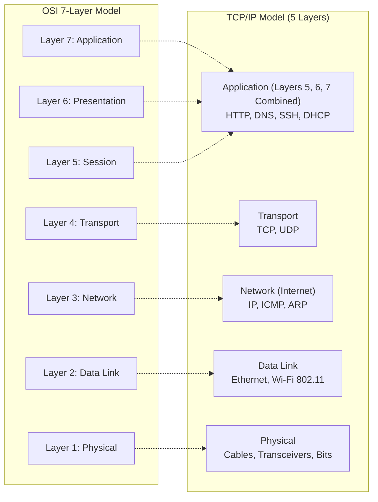
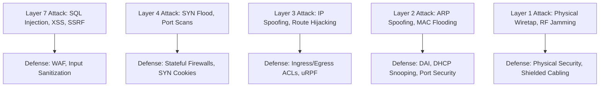

# what is TCP/IP and OSI? // FREE CCNA // EP 3

**Tags:** #networking #osi-model #tcpip #history #arpanet #ccna #alvar-method
**Category:** Cybersecurity / 01-Networking
**YouTube Reference:** [what is TCP/IP and OSI? // FREE CCNA // EP 3](https://www.youtube.com/watch?v=CRdL1PcherM&list=PLIhvC56v63IJVXv0GJcl9vO5Z6znCVb1P&t=9s)

---

## 1. Unconditional Truths (The Axioms)

- **A networking model is a standardized contract, not physical hardware:** It establishes a vendor-neutral set of rules, headers, and protocol abstractions so that any device (a Raspberry Pi, an iPhone, a Windows workstation, or a Cisco core router) can communicate seamlessly across the globe.
- **The Internet runs on TCP/IP, but engineers think and troubleshoot in OSI:**
  - The **TCP/IP model** is the actual protocol suite implemented in operating system kernels worldwide.
  - The **OSI model (Open Systems Interconnection)** is the conceptual 7-layer framework used across the industry for modular troubleshooting (e.g., *"Is this a Layer 1 cable fault or a Layer 7 application error?"*).
- **Encapsulation is strictly hierarchical:** Data passed down the stack is encapsulated with layer-specific headers; de-encapsulation verifies and strips those headers as data moves up to peer layers.

---

## 2. Motivated Discovery ("Why does this exist?")

*Imagine a world where charging an iPhone with an Android cable fails—now apply that to every single computer.*

In the 1960s and 1970s, before open standards existed, computing was locked in proprietary silos. IBM built proprietary networks that only spoke to IBM machines; DEC built networks that only spoke to DEC hardware. They spoke completely different languages: one spoke French, the other spoke Japanese, and neither could translate.

### The Spark: ARPANET (1969–1977)
In 1969, the United States Department of Defense (DoD) funded **ARPANET**, pioneering **packet switching**—the radical idea of breaking data into discrete chunks (packets) and routing them across independent nodes.

![[arpanet-logical-map-1977.png]]
*Figure 1: Historical ARPANET Logical Map (March 1977) — the foundational packet-switched network connecting research nodes (Stanford, MIT, Harvard, Utah, UCLA).*

While ARPANET proved packet switching worked, it lacked a universal language for heterogeneous computers. To prevent permanent corporate vendor lock-in, international committees convened to create open, standard networking models:
1. **The ISO OSI Model (1984):** Conceptual perfection with 7 distinct architectural layers.
2. **The TCP/IP Model (DoD):** Practical, streamlined, and rapidly adopted as the engine of the Internet.

---

## 3. Architecture & Visual Comparison

Below is NetworkChuck's blackboard comparison illustrating how the 7 OSI layers collapse into the modern TCP/IP model:

![[networkchuck-osi-vs-tcpip-blackboard.png]]
*Figure 2: OSI 7-Layer Model vs Modern TCP/IP Model with bidirectional mnemonics.*

### Essential Mnemonics to Memorize the 7 Layers:
- **Top-to-Bottom (Layer 7 down to Layer 1):**
  - **A**ll **P**eople **S**eem **T**o **N**eed **D**ata **P**rocessing
  - *(NetworkChuck variation: **A**ll **P**eople **S**leep **T**hrough **N**etwork **D**ata **P**ass)*
- **Bottom-to-Top (Layer 1 up to Layer 7):**
  - **P**lease **D**o **N**ot **T**hrow **S**ausage **P**izza **A**way

---

## 4. First-Principles Layer Mechanics & Device Taxonomy

| Layer Number | OSI Layer Name | Primary Function | Typical Devices / Protocols |
| :--- | :--- | :--- | :--- |
| **Layer 7** | Application | Direct interface between user software and network services | HTTP, HTTPS, DNS, SSH, FTP |
| **Layer 6** | Presentation | Syntax translation, compression, encryption/decryption | TLS/SSL, JPEG, ASCII |
| **Layer 5** | Session | Opening, managing, and closing communication dialogs | RPC, NetBIOS, SMB sessions |
| **Layer 4** | Transport | End-to-end communication, reliability, port numbers | TCP, UDP, Port numbers (e.g. 80, 443) |
| **Layer 3** | Network | Logical addressing and path determination across subnets | **Routers**, Layer 3 Switches, IP, ICMP |
| **Layer 2** | Data Link | Physical addressing and node-to-node framing on local link | **Switches**, Bridges, WAPs (802.11 frames), MAC addresses |
| **Layer 1** | Physical | Electrical, optical, or radio signal modulation (raw bits) | **Hubs**, **Repeaters**, Cables (Cat6, Fiber), Transceivers |

---

## 5. Cybersecurity Threat Matrix Mapped to OSI Layers

Understanding layers allows security engineers to isolate vulnerabilities and deploy defense-in-depth:

---

## 6. Official Video FAQ & CCNA Exam Questions (End of Episode 3)

At the conclusion of Episode 3, NetworkChuck breaks down official CCNA practice questions provided by Boson Software:

### Question 1:
> **Which of the following operates primarily at Layer 2 of the OSI model?**  
> *(Select the best answer)*  
> - A) Router  
> - B) Switch  
> - C) Hub  
> - D) Wireless Access Point (WAP)  

**Answer:** **B) Switch**  
**Explanation:**  
- A **Switch** operates primarily at **Layer 2 (Data Link)** because it inspects and forwards frames based on Layer 2 MAC addresses.
- A **Router** operates primarily at **Layer 3 (Network)** using IP addresses.
- A **Hub** operates at **Layer 1 (Physical)** because it has zero awareness of MAC addresses and blindly repeats electrical signals across all ports.
- A **WAP** bridges 802.11 wireless frames to 802.3 Ethernet frames (operating across both Layer 1 and Layer 2), but the device that *primarily* defines Layer 2 switching is a switch.

---

### Question 2:
> **Which of the following devices operate primarily at the Physical Layer (Layer 1) of the OSI model?**  
> *(Select two choices)*  
> - A) Repeaters  
> - B) Switches  
> - C) Hubs  
> - D) Routers  
> - E) Bridges  

**Answer:** **A) Repeaters** and **C) Hubs**  
**Explanation:**  
- **Hubs** and **Repeaters** are Layer 1 devices. They do not parse frame headers, MAC addresses, or IP packets; they regenerate and amplify raw physical electrical or optical signals over distance.
- **Switches** and **Bridges** operate at Layer 2 (Data Link) inspect MAC addresses.
- **Routers** operate at Layer 3 (Network).

---

## 7. Gotchas & Edge Cases

- ⚠️ **Gotcha: Thinking TCP/IP and OSI are Competitors Today:**
  - They are not competing. The TCP/IP model won the battle of adoption and is what computers use. The OSI model remains the universal reference map for diagnostics and certification exams.
- ⚠️ **Gotcha: Forgetting that WAPs Touch Both Layer 1 and Layer 2:**
  - A Wireless Access Point converts radio wave frequencies (Layer 1) into physical Ethernet voltages (Layer 1), while simultaneously converting 802.11 Wi-Fi frames into 802.3 Ethernet frames (Layer 2).
