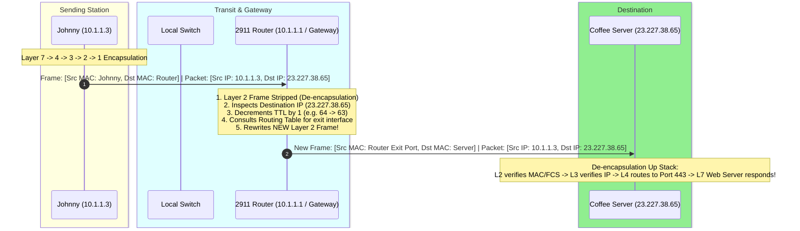

# REAL LIFE example!! (TCP/IP and OSI layers) // FREE CCNA // EP 4

**Tags:** #networking #osi-model #tcpip #encapsulation #packet-trace #packet-tracer #ccna #alvar-method
**Category:** Cybersecurity / LainNet
**YouTube Reference:** [REAL LIFE example!! (TCP/IP and OSI layers) // FREE CCNA // EP 4](https://www.youtube.com/watch?v=3kfO61Mensg&list=PLIhvC56v63IJVXv0GJcl9vO5Z6znCVb1P&t=48s)
**Source Lab File:** `labs/ccna_ep2.pkz`

---

## 1. Unconditional Truths (The Axioms)

- **Encapsulation is the "Envelope-in-an-Envelope" Pattern:**  
  Application data is wrapped into a **Transport Segment**, which is wrapped into an **IP Packet**, which is wrapped into an **Ethernet Frame**, and finally serialized into physical **Bits**.
- **The Protocol Data Unit (PDU) Hierarchy:**
  - Layer 7–5: **Data / Payload**
  - Layer 4: **Segment** (TCP) / **Datagram** (UDP)
  - Layer 3: **Packet**
  - Layer 2: **Frame**
  - Layer 1: **Bits**
  - *(Mnemonic: **D**on't **S**ome **P**eople **F**ly **B**y?)*
- **The Golden Invariant of Hop-by-Hop Delivery:**  
  As a packet traverses routers across the world:
  - **Layer 3 IP Addresses remain constant** end-to-end (`10.1.1.3` $\rightarrow$ `23.227.38.65`).
  - **Layer 2 MAC Addresses change at every single router hop** (Johnny's frame destination is the **Default Gateway**, NOT the remote server).

---

## 2. Packet Tracer Lab Setup: Isolating Web Traffic

In `labs/ccna_ep2.pkz`, the network topology features:
- **Client Machine:** Laptop "Johnny" (IP: `10.1.1.3`, MAC: `00D0.9752.8936`)
- **Default Gateway:** 2911 Router (IP: `10.1.1.1`, MAC: `0002.17EB.1D01`)
- **Remote Web Server:** "NetworkChuck Coffee" (IP: `23.227.38.65`)

### Filtering Visible Events
To prevent background protocol chatter (CDP, STP, DTP) from cluttering the simulation, Packet Tracer's **Event List Filters** must be configured to isolate web traffic:

![[ep04-pt-event-list-filter.png]]
*Figure 1: Packet Tracer Event List Filters set to capture only Web Traffic (`ARP`, `DNS`, `HTTP`, `HTTPS`, `ICMP`).*

```text
Filters Enabled:
├── ARP   -> Resolves Gateway IP (10.1.1.1) to Gateway MAC (0002.17EB.1D01)
├── DNS   -> Resolves hostname (networkchuck.coffee) to Web Server IP (23.227.38.65)
├── TCP   -> Manages 3-Way Handshake (SYN -> SYN-ACK -> ACK) on port 80/443
└── HTTPS -> The actual encrypted application web data
```

---

## 3. Layer-by-Layer Encapsulation Walkthrough

When Johnny opens his web browser and navigates to `https://networkchuck.coffee`, the OS networking stack builds the transmission from the top down:

### Step 1: Layer 7 (Application Layer) — The Raw Data
- **Process:** The browser creates an HTTP/HTTPS GET request payload.
- **PDU:** **Data** (`HTTP GET /`)
- At this stage, it is purely application data; it has no concept of IP addresses, ports, or cables.

---

### Step 2: Layer 4 (Transport Layer) — The TCP Segment

The operating system hands the Data down to Layer 4 to establish reliable delivery:

![[ep04-nc-blackboard-l4-tcp-segment.png]]
*Figure 2: NetworkChuck's blackboard showing Layer 7 Data being wrapped into a Layer 4 TCP Segment envelope with Port 443.*

- **Action:** Layer 4 wraps the Data inside a **TCP Header**.
- **PDU Created:** **Segment**
- **Core Metadata Attached:**
  - **Source Port:** `1025` (an ephemeral dynamic port assigned by Johnny's OS for this browser tab).
  - **Destination Port:** `443` (well-known port for HTTPS web traffic; port 80 for HTTP).
  - **Control Flags:** `SYN` flag set to begin the TCP 3-Way Handshake.
  - **Sequence Number:** Initial sequence number for tracking packet order and preventing loss.

---

### Step 3: Layer 3 (Network Layer) — The IP Packet

The TCP segment is handed down to Layer 3 for logical routing across subnets:

![[ep04-nc-blackboard-l3-ip-packet.png]]
*Figure 3: Layer 4 Segment wrapped into an IP Packet envelope with Source IP (10.1.1.3) and Destination IP (23.227.38.65).*

- **Action:** Layer 3 wraps the Segment inside an **IPv4 Header**.
- **PDU Created:** **Packet**
- **Core Metadata Attached:**
  - **Source IP:** `10.1.1.3` (Johnny's private IP).
  - **Destination IP:** `23.227.38.65` (NetworkChuck Coffee server IP).
  - **Protocol ID:** `6` (identifies that the payload inside is TCP).
  - **Time to Live (TTL):** Set to `64` or `128` (prevents routing loops by decrementing by 1 at each router).

---

### Step 4: Layer 2 (Data Link Layer) — The Ethernet Frame

Layer 3 hands the Packet to Layer 2 to prepare for local physical transmission:

- **Action:** Layer 2 wraps the Packet in an **Ethernet II Header** and adds a **Frame Check Sequence (FCS)** trailer.
- **PDU Created:** **Frame**
- **The Critical CCNA Observation:**
  - **Source MAC:** `00D0.9752.8936` (Johnny's NIC).
  - **Destination MAC:** `0002.17EB.1D01` (**The Router's Default Gateway Interface**, NOT the Coffee Server!).
  - **Why?** Johnny cannot ARP for `23.227.38.65` because it is outside his local subnet (`10.1.1.0/24`). Johnny addresses the Layer 2 frame to his local router so the router can forward it.

---

### Step 5: Layer 1 (Physical Layer) — Electrical Bits

- **Action:** The Network Interface Card (NIC) converts the entire Ethernet Frame into physical electrical voltage pulses transmitted over the Cat6 copper cable to the local switch.

---

## 4. Live Verification in Packet Tracer (The PDU Inspector)

Clicking on the outbound envelope on Johnny's workstation in Packet Tracer Simulation Mode reveals the exact live PDU data:

![[ep04-pt-pdu-johnny-out-layers.png]]
*Figure 4: Packet Tracer PDU Information window at Device Johnny showing the complete Outbound Layer 1–7 stack.*

### Dissecting Johnny's Outbound Stack:
```text
┌─────────────────────────────────────────────────────────────────────────────┐
│ PDU Information at Device: Johnny                                           │
├─────────┬───────────────────────────────────────────────────────────────────┤
│ Layer 7 │ HTTPS -> "1. The HTTP client sends a HTTP request to the server." │
├─────────┼───────────────────────────────────────────────────────────────────┤
│ Layer 4 │ TCP   -> Src Port: 1025, Dst Port: 443                            │
├─────────┼───────────────────────────────────────────────────────────────────┤
│ Layer 3 │ IP    -> Src IP: 10.1.1.3, Dest IP: 23.227.38.65                  │
├─────────┼───────────────────────────────────────────────────────────────────┤
│ Layer 2 │ Eth II-> 00D0.9752.8936 >> 0002.17EB.1D01 (Johnny >> Gateway!)    │
├─────────┼───────────────────────────────────────────────────────────────────┤
│ Layer 1 │ Port  -> FastEthernet0 (Bits modulated onto physical wire)        │
└─────────┴───────────────────────────────────────────────────────────────────┘
```

---

## 5. Hop-by-Hop Router De-Encapsulation & Re-Encapsulation



---

## 6. Official Video FAQ & CCNA Exam Questions (End of Episode 4)

At the conclusion of Episode 4, NetworkChuck reviews Boson Software practice exam questions:

### Question 1:
> **Which of the following are functions of the Application Layer (Layer 7) in the OSI model?**  
> *(Select three choices)*  
> - A) Identifying communication partners  
> - B) Ensuring error-free data delivery between devices  
> - C) Managing communications between applications  
> - D) Managing logical and physical addressing  
> - E) Directing data to the correct program  

**Answers:** **A, C, and E**  
**Explanation:**  
- **D is eliminated:** Logical addressing is Layer 3 (IP); physical addressing is Layer 2 (MAC).
- **B is eliminated:** Error-free data delivery is handled by the **Transport Layer (Layer 4)** via TCP sequence numbers and acknowledgments.
- **A, C, E are correct:** Layer 7 coordinates between application processes, identifies partner availability, and routes data directly to the user's running software.

---

### Question 2:
> **Which of the following relies on a three-way handshake in order to provide connection-oriented reliable data transfer between networked computers?**  
> *(Select the best answer)*  
> - A) ARP  
> - B) DNS  
> - C) TCP  
> - D) UDP  
> - E) RARP  

**Answer:** **C) TCP**  
**Explanation:**  
- **TCP (Transmission Control Protocol)** operates at Layer 4 and establishes connections using the **3-Way Handshake (`SYN` $\rightarrow$ `SYN-ACK` $\rightarrow$ `ACK`)** to guarantee reliable delivery.
- UDP is connectionless (no handshake, no retries).
- ARP and RARP operate at Layer 2/3 for address resolution. DNS operates at Layer 7 (typically over UDP port 53).

---

## 7. Cybersecurity Threat Modeling (Offensive & Defensive)

1. **Ephemeral Port Exhaustion:**  
   When a client opens thousands of rapid connections, its OS runs out of dynamic Layer 4 source ports (ports `1024`–`65535`), causing denial-of-service for new outbound sessions.
2. **Layer 2 Gateway Spoofing (ARP Poisoning):**  
   Because Johnny relies completely on Layer 2 to reach the router (`0002.17EB.1D01`), an attacker on the same switch can broadcast fake ARP replies claiming that `10.1.1.1` is at the *attacker's* MAC address, intercepting all of Johnny's HTTPS traffic before it reaches the real router.
3. **Defense:** Enable **Dynamic ARP Inspection (DAI)** and **DHCP Snooping** on the switch to cryptographically validate IP-to-MAC bindings.
