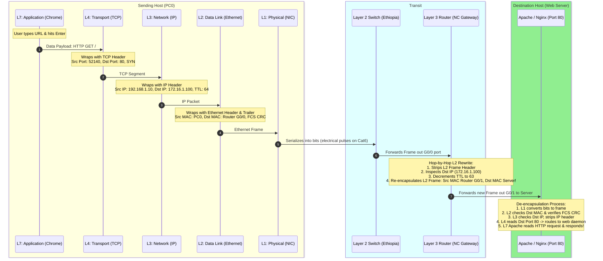

# REAL LIFE example!! (TCP/IP and OSI layers) // FREE CCNA // EP 4

**Tags:** #networking #osi-model #tcpip #encapsulation #packet-trace #ccna #alvar-method
**Category:** Cybersecurity / 01-Networking
**YouTube Reference:** [REAL LIFE example!! (TCP/IP and OSI layers) // FREE CCNA // EP 4](https://www.youtube.com/watch?v=3kfO61Mensg&list=PLIhvC56v63IJVXv0GJcl9vO5Z6znCVb1P&t=48s)

---

## 1. Unconditional Truths (The Axioms)

- **Encapsulation is envelope wrapping; De-encapsulation is envelope opening:** As data travels down the protocol stack, each layer wraps the payload inside its own header/trailer. The receiving end peels off each envelope one layer at a time.
- **Protocol Data Units (PDUs) change names at every tier:**
  - Layer 7–5: **Data**
  - Layer 4: **Segment** (TCP) or **Datagram** (UDP)
  - Layer 3: **Packet**
  - Layer 2: **Frame**
  - Layer 1: **Bits**
  - *(Mnemonic: **D**on't **S**ome **P**eople **F**ly **B**y?)*
- **IP addresses remain end-to-end; MAC addresses change hop-by-hop:** The Source and Destination IP addresses never change as a packet moves through the network (prior to NAT). The Source and Destination MAC addresses change at *every single router interface*.

---

## 2. Motivated Discovery ("Why trace a live packet?")

Abstract layer diagrams are meaningless without understanding what actually traverses the wire. By opening a web browser in a local coffee shop and visiting `http://networkchuck.coffee`, we can observe the micro-second lifecycle of a packet: from user keystroke to electromagnetic signal, router hop, and server de-encapsulation.

---

## 3. Step-by-Step Real-Life Encapsulation Journey



---

## 4. First-Principles Header Breakdown

```
[Sending at Host PC0]
┌───────────────────────────────┬───────────────────────────────┬──────────────────────┬─────────────┐
│ Layer 2 Frame Header          │ Layer 3 IP Packet Header      │ Layer 4 TCP Segment  │ L7 Payload  │
│ Src MAC: PC0                  │ Src IP: 192.168.1.10          │ Src Port: 52140      │ HTTP GET /  │
│ Dst MAC: Router G0/0 (Gateway)│ Dst IP: 172.16.1.100 (Server) │ Dst Port: 80         │             │
└───────────────────────────────┴───────────────────────────────┴──────────────────────┴─────────────┘
                                                │
                                                ▼ (Traverses Router Gateway)
[Arriving at Web Server]
┌───────────────────────────────┬───────────────────────────────┬──────────────────────┬─────────────┐
│ Layer 2 Frame Header (REWRITTEN) Layer 3 IP Packet Header (UNCHANGED) Layer 4 TCP Segment L7 Payload  │
│ Src MAC: Router G0/1          │ Src IP: 192.168.1.10          │ Src Port: 52140      │ HTTP GET /  │
│ Dst MAC: Server (Target)      │ Dst IP: 172.16.1.100          │ Dst Port: 80         │             │
└───────────────────────────────┴───────────────────────────────┴──────────────────────┴─────────────┘
```

---

## 5. Official Video FAQ & CCNA Exam Questions (End of Episode 4)

At the end of Episode 4, NetworkChuck tests viewers with high-level CCNA / CCNP practice questions from Boson Software:

### Question 1:
> **Which of the following are functions of the Application Layer (Layer 7) in the OSI model?**  
> *(Select three choices)*  
> - A) Identifying communication partners  
> - B) Ensuring error-free data delivery between devices  
> - C) Managing communications between applications  
> - D) Managing logical and physical addressing  
> - E) Directing data to the correct program  

**Answers:** **A, C, and E**  
**Explanation & Elimination Process:**  
- **D is eliminated:** Managing logical addressing is Layer 3 (IP), and physical addressing is Layer 2 (MAC).  
- **B is eliminated:** Ensuring error-free, reliable data delivery is handled by the **Transport Layer (Layer 4)** via TCP error-checking and sequence acknowledgments.  
- **A, C, and E are correct:** The Application Layer identifies available communication partners, synchronizes cooperating applications, and passes application payload directly to user software processes.  
*(Note: Data encryption and formatting belongs to Presentation Layer 6 in the OSI model, though it is grouped into Application in the 5-layer TCP/IP model).*

---

### Question 2:
> **Which of the following relies on a three-way handshake in order to provide connection-oriented reliable data transfer between networked computers?**  
> *(Select the best answer)*  
> - A) ARP  
> - B) DNS  
> - C) TCP  
> - D) UDP  
> - E) RARP  

**Answer:** **C) TCP**  
**Explanation & Elimination Process:**  
- **ARP (Address Resolution Protocol):** Resolves IP addresses to MAC addresses (Layer 2/3). It does not use a 3-way handshake.  
- **DNS (Domain Name System):** Resolves human hostnames to IP addresses, operating at Layer 7 (typically over UDP port 53).  
- **RARP (Reverse ARP):** Legacy protocol used by diskless workstations to discover their IP address from their MAC address.  
- **UDP (User Datagram Protocol):** A Transport Layer protocol, but it is **connectionless and unreliable** (fire-and-forget; no handshake, no acknowledgments).  
- **TCP (Transmission Control Protocol):** Operates at **Layer 4 (Transport)** and establishes a connection using the **3-way handshake (`SYN` → `SYN-ACK` → `ACK`)**, providing sequencing, retransmissions, and flow control.

---

## 6. Cybersecurity Implications & Threat Modeling

1. **Port Scanning Reconnaissance (Layer 4):**
   - Tools like `nmap -sS` send a raw `SYN` packet to target ports. If the server replies with `SYN-ACK`, the attacker knows that application port is open without completing the handshake (Stealth SYN scan).
2. **SYN Flood Denial-of-Service:**
   - Attackers spoof thousands of IP addresses and send endless `SYN` packets without completing the third step (`ACK`). The victim server keeps embryonic connection states in RAM until its TCP backlog queue fills up, crashing network access.
3. **Defense:**
   - **SYN Cookies:** The server encodes connection state into the TCP sequence number rather than allocating kernel memory until the final `ACK` arrives.
