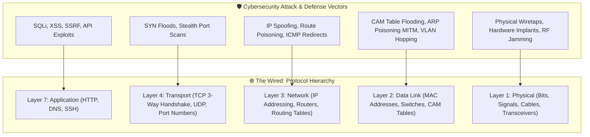
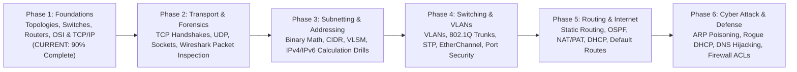

# 🌐 LainNet // The Wired Protocol Architecture & Networking Command Center

> *"No matter where you go, everyone's always connected."*  
> — **Serial Experiments Lain (1998)**

[](https://www.cisco.com)
[](https://www.netacad.com)
[](https://github.com/karnVen/LainNet)
[](https://obsidian.md)
[](#-where-we-are-right-now-active-sprint)

---

## ⚡ What is LainNet?

**LainNet** is a synthesized, first-principles **Computer Networking and Cybernetic Command Center** engineered inside an Obsidian Knowledge Vault.

Named after the seminal 1998 cyberpunk anime *Serial Experiments Lain* and its conceptualization of **"The Wired"**, this repository documents the complete journey from raw copper voltages and electrical pulses to enterprise routing architectures, wire-level packet forensics, and low-level protocol exploitation.

Every single concept here follows the **Alvar Method (Axioms → Motivated Discovery → Architecture Mapping → First-Principles Mechanics → Cyber Threat Modeling → Socratic Drills)**.



---

## 📍 Where We Are Right Now (Active Sprint)

> **Last Push Status:** October 13, 2026 | **Episodes Mastered:** 5 / 24  
> **Course Track:** [NetworkChuck Free CCNA (200-301) Course](https://youtube.com/playlist?list=PLIhvC56v63IJVXv0GJcl9vO5Z6znCVb1P)  
> **Companion Agent:** AI-bou (Antigravity)

| Episode | Title & Direct Vault Link | Packet Tracer Lab / Assets | Key Breakthroughs & Mechanics | Status |
| :---: | :--- | :--- | :--- | :---: |
| **00** | [[00 - FREE CCNA -- What is a Network -- Day 0\|FREE CCNA // What is a Network? // Day 0]] | Conceptual Topologies | Sneakernet limits, Star vs Mesh, Bandwidth vs Throughput vs Goodput | ✅ **Mastered** |
| **01** | [[01 - What is a SWITCH -- FREE CCNA -- Day 1\|What is a SWITCH? // FREE CCNA // Day 1]] | `labs/ccna_day1.pkz` | 3 Switch Rules (Learn, Forward, Flood), CAM table aging, `macof` flooding defense | ✅ **Mastered** |
| **02** | [[02 - What is a ROUTER -- FREE CCNA -- EP 2\|What is a ROUTER? // FREE CCNA // EP 2]] | `labs/ccna_ep2.pkz` | Broadcast domain isolation, Default Gateway logic, Hop-by-Hop MAC address rewrite | ✅ **Mastered** |
| **03** | [[03 - what is TCPIP and OSI -- FREE CCNA -- EP 3\|what is TCP/IP and OSI? // FREE CCNA // EP 3]] | `attachments/arpanet-logical-map-1977.png`<br/>`attachments/networkchuck-osi-vs-tcpip-blackboard.png` | 1969 ARPANET history, OSI 7-Layer vs TCP/IP 5-Layer, Official Boson Practice FAQ | ✅ **Mastered** |
| **04** | [[04 - REAL LIFE example (TCPIP and OSI layers) -- FREE CCNA -- EP 4\|REAL LIFE example!! (TCP/IP and OSI layers) // FREE CCNA // EP 4]] | Simulation Mode Packet Flow | End-to-end Coffee Shop request flow, PDU transformations, TCP 3-way handshake FAQ | ✅ **Mastered** |
| **05** | [[05 - How the OSI model works on YouTube -- FREE CCNA -- EP 5\|How the OSI model works on YouTube // FREE CCNA // EP 5]] | Transport Layer Lab | TCP vs UDP, Socket Pairs (`IP:Port`), Streaming buffer mechanics | ⏳ **UP NEXT** |
| **06** | [[06 - DO NOT design your network like this -- FREE CCNA -- EP 6\|DO NOT design your network like this!! // FREE CCNA // EP 6]] | 3-Tier Enterprise Lab | Core, Distribution, Access layers, Redundant loops & Spanning Tree | ⚪ Scheduled |

---

## 🚀 Where We Want To Be (The Master Roadmap)

Our objective is complete mastery of network architecture and wire-level protocol behavior, building an unshakeable foundation for **offensive exploitation (red team)** and **enterprise architecture defense (blue team)**:



---

## 📦 Hands-On Labs Catalog (`labs/`)

This repository contains real Cisco Packet Tracer lab files (`.pkz`) paired directly with NetworkChuck's curriculum:

- **`labs/ccna_day1.pkz`**:
  - Switch MAC Address Table learning.
  - Simulation Mode inspection of ARP broadcasts and unicast packet delivery.
  - Cisco IOS CLI verification: `show mac address-table`, `clear mac address-table dynamic`.
- **`labs/ccna_ep2.pkz`**:
  - The "NetworkChuck Coffee" multi-subnet infrastructure.
  - Cross-subnet routing through interface `G0/0` (`192.168.1.1`) and `G0/1` (`172.16.1.1`).
  - Resolving remote web servers (`172.16.1.100`) and testing default gateway dependencies.

---

## 🧠 The Alvar Note Architecture

Every concept document in LainNet enforces a zero-fluff, first-principles structure:

1. **Unconditional Truths (The Axioms):** What is undeniably true without caveats?
2. **Motivated Discovery ("Why does this exist?"):** What catastrophic engineering failure or bottleneck forced humans to invent this?
3. **Architecture & Dependency Map:** Mermaid visual diagrams and packet layouts.
4. **First-Principles Mechanics:** Mathematical formulas, frame/packet header dissection, and Cisco CLI commands.
5. **Cybersecurity Threat Modeling:** How hackers exploit this layer and how defenders patch it.
6. **Official Exam Practice & FAQs:** Real CCNA / CCNP practice exam questions with deep answer explanations.

---

## 📓 Using With Obsidian

1. Clone this repository into your Obsidian vault directory:
   ```bash
   git clone https://github.com/karnVen/LainNet.git
   ```
2. Open Obsidian and select **"Open folder as vault"**.
3. All Markdown notes, wikilinks (`[[...]]`), embedded PNG diagrams (`![[...]]`), and Mermaid state charts will render natively with zero configuration!

---

## 🛡️ Pre-Push Invariant (Global Rule)
> *`README.md` and `SESSION_STATE.md` are automatically synchronized and updated before every single git push to maintain a live, immutable log of our learning trajectory.*
